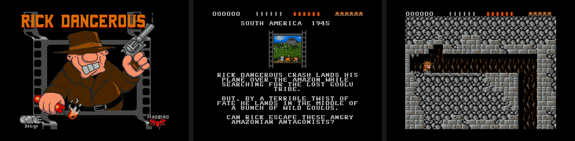

# Rick Dangerous for Game & Watch Retro-Go SD



**Rick Dangerous** (Core Design, 1989) on the Nintendo Game & Watch (Zelda
or Mario) with the [Retro-Go SD](https://github.com/sylverb/game-and-watch-retro-go-sd)
firmware, as a **GWHB homebrew**: a `.bin` and its pack dropped in
`/homebrews/`, no firmware rebuild needed.

The game is [xrick](http://www.bigorno.net/xrick/), BigOrno's
re-implementation of Rick Dangerous, in Pierluigi Vicinanza's version
(2014, the one Rockbox uses: data in files, a clean system layer). The four
worlds of the original (South America, Egypt, Schwarzendumpf castle, the
missile base), its Atari ST graphics, sounds and music.

The project is built from
[retro-go-sd-templates](https://github.com/sylverb/retro-go-sd-templates)
and talks to the firmware only through the firmware ABI.

## Installation

Requires Retro-Go SD **v2.0.0-rc1 or later** (firmware ABI v2).

1. Download `RickDangerous-vX.Y.Z.zip` from the
   [releases](https://github.com/landsat77/rick-dangerous-gnw/releases)
   (or build it, below).
2. Copy its `homebrews` folder to the SD card's root:
   ```
   /homebrews/RickDangerous.bin     the homebrew (Homebrew tab)
   /homebrews/RickDangerous.xrk     the game's data (3.4 MB), same name
   ```
3. Start "Rick Dangerous" from the **Homebrew** tab. The first start copies
   the pack to the external flash ("Caching game file"); the game then runs
   from there.

High scores: `/retro-go/saves/xrick/highscores.bin`. See
[INSTALL.md](INSTALL.md) (English and French).

## Controls

| Game & Watch | Rick Dangerous |
|---|---|
| D-pad | Walk, climb, crawl (down) |
| A | Fire: with up = shoot, with down = drop a bomb, with left/right = poke with the stick; starts the game |
| B | Jump (same as up) |
| GAME or TIME | Pause |
| PAUSE/SET | Retro-Go menu (save states, volume…) |

On the high-score screen: up/down change the letter, left/right move, A
validates.

## How it works

- `src/xrick/`: the game (xrick, unchanged except under `#ifdef GNW`:
  the loop driven one frame at a time, a CRC-32 instead of miniz, and an
  out-of-bounds read fixed in the enemies' randomiser, `e_them.c`).
- `src/port/`: xrick's system layer for the Game & Watch (`xr_sys.c`:
  memory, video, sound, time, buttons; `xr_pack.c`: the pack; `xr_main.c`:
  the homebrew).
- **Pack**: `tools/make_pack.py` puts xrick's data files in one file read in
  place from the external flash: graphics are decoded into RAM by xrick
  (~176 KB used), the sounds (8-bit 22050 Hz) are played straight from
  flash.
- **Timing**: the LCD runs at 50 Hz, one game frame every second VBL: 25
  frames per second, xrick's 40 ms. The game's clock is the frame count, so
  a run is deterministic. In gwemu the console is about 2 % busy.
- **Save states**: every variable of the game is linked into two sections
  of their own (`xrstate_data`, `xrstate_bss`); a state is those two blocks
  plus the used part of xrick's memory block, about 250 KB
  (`src/port/xr_state.c`).

## Building

```
make            # → RickDangerous.bin + RickDangerous.xrk (build/sd/homebrews/)
make host       # PC version (SDL2): ./RickDangerous_host <dir>/RickDangerous.bin
make docker     # the homebrew inside the Retro-Go SD builder image
```

Needs `arm-none-eabi-gcc` (hard-float, with newlib), GNU Make, Python 3
with Pillow, git. On Ubuntu:
`sudo apt install gcc-arm-none-eabi libnewlib-arm-none-eabi libsdl2-dev python3-pil`.

The game's data comes from xrick's own repository
([foolsh/xrick](https://github.com/foolsh/xrick), `assets` folder), fetched
by `make` at a fixed commit into `build/xrick-data/`; `make` then builds the
pack.

The PC version takes the path of the `.bin` and reads the `.xrk` beside it.
Keys: arrows, X = A, Z = B, S = GAME, F1/F2 = save/load state. Scripted
runs (for tests): `XR_SCRIPT`, `XR_SHOTS`, `XR_FRAMES`… (see
`src/port/xr_main.c`).

## Credits and licences

- Rick Dangerous: © 1989 Core Design, published by Firebird. Graphics, maps
  and sounds are theirs.
- xrick: © 1998-2002 BigOrno, © 2008-2014 Pierluigi Vicinanza, released
  "in the spirit of the GNU GPL" (see `src/xrick/README.md`).
- Game & Watch port (`src/port/`, tools) and the Retro-Go SD SDK: MIT
  (`LICENSE`).
